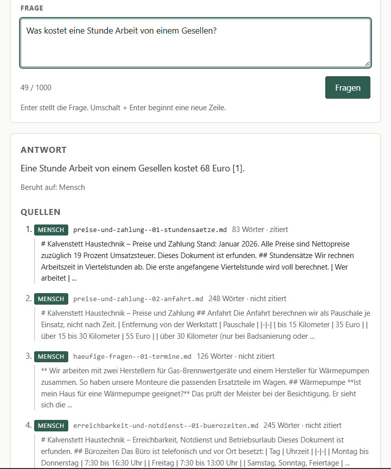

# Andur

[](https://github.com/andy-builds-ai/ask-andur/actions/workflows/ci.yml)

Andur answers questions from a company's own documents and shows, for every
answer, the passages it was built from and whether a person or a machine
wrote them. It is meant for a team that keeps its handbooks, policies and
notes in files and would rather ask than search, and one installation
serves several companies without one ever seeing another's documents. It
runs on AWS, defined as code, with no part that bills a monthly base fee.



A walkthrough of one question, recorded on 28.09.2026 in eu-west-1 with Nova
Pro and six passages per question, the workspace and key already entered: what the guarantee on painted
windows covers and what to do to keep it, answered with two citations out of
four sources, and the cost line under them (1357 tokens in, 73 out, 0.002717
USD, 3425 ms in the function):


## Measured

- **Where the data is:** in `eu-west-1` (Ireland) — documents, vectors,
  questions and answers. Models run in the region or behind an EU inference
  profile, never a global one.
- **How often the answer is right:** 30 fixed questions — 22 the documents
  answer, 4 the guardrail must refuse, 4 no document answers. Nova Pro, the
  configured model, got 28 right with six passages per question on
  28.09.2026 and cited the expected document in 20 of the 22 it should
  answer. Since the function hands it ten passages, two runs of the 22
  answerable questions got 22 and 21 right, citing the expected document
  in 22 and 21 (decisions: [docs/decisions.md](docs/decisions.md)). In the
  comparison the same day, at six passages, Nova Pro, Claude Haiku 4.5 and
  Claude Sonnet 4.6 got 29 right, Nova 2 Lite 28, and Nemotron 3 Super
  answered none in eu-west-1. Table and method:
  [scripts/README.md](scripts/README.md#evaluate--which-model-answers-best).
- **Cost per question:** 0.0043 USD on average for an answered question
  with Nova Pro at ten passages (0.0032 to 0.0062, 43 answers), 0.0029 USD
  at six (0.0019 to 0.0045, 39 answers), 0.00015 USD for one the guardrail
  refuses (measured at six) — `cost_usd` of those runs on 28.09.2026, at that
  day's prices. Details: [docs/costs.md](docs/costs.md).
- **Answer time:** 0.7 to 4.4 seconds inside the function for four questions
  on the page with Nova Pro, the first after a deploy included
  (`latency_ms`); a median of 1.8 seconds from retrieval to cost line for
  the 22 answerable questions, measured from a laptop in Germany.
- **Tests:** 540, all passing, without AWS — 29 seconds on a local laptop on
  28.09.2026.
- **Documents:** 37 Markdown documents of two fictional companies, uploaded
  as 147 sections so that a hit is a passage, not a page.
- **Key budget:** a key allows 10 questions within 48 hours of its first —
  at the measured cost, about 0.04 USD per key with Nova Pro.

## Decisions

Everything with a monthly base fee is left out: S3 Vectors behind a Bedrock
knowledge base instead of a search cluster. A key is a budget, not a
password, counted in one conditional DynamoDB write. Two guardrails, one on
the answer and one that masks the excerpts of its sources. Every AWS call has
a timeout, and their sum stays under the function's own; a model call AWS
turns away is made once more while CloudFront still waits. Everything runs
in Ireland, so the data stays in the EU. Why each of these, and 45 more,
with dates: [docs/decisions.md](docs/decisions.md).

## Limits

- **Personal details are filtered, not guaranteed.** The masking is
  statistical. In the browser acceptance a first name without a surname
  stayed readable in two excerpts, while the answer next to them was masked.
- **Citations are the model's.** One of the four answered live questions
  carried no `[n]` at all, although the grounding check scored it 1.0. The
  prompt asks for citations; the model does not always give them.
- **The grounding threshold is a starting point.** 0.7 is the value AWS
  works its example with, not a tuned one. A correct answer scored 0.73, just
  above it. Every answer logs both scores, so the threshold can be moved on
  evidence.

## How it was built

Built with Claude Code as a coding partner; the decisions, the reviews and
the measurements are the author's.

## Try it

Needs Python 3.11+, Node.js, the AWS CDK (`npm install -g aws-cdk`) and AWS
credentials. Everything goes to `eu-west-1` (Ireland), so documents, vectors
and answers stay in the EU.

```bash
python -m venv .venv && . .venv/Scripts/activate   # Linux/macOS: . .venv/bin/activate
pip install -e ".[dev]"
pytest -q                                  # 540 tests, no AWS needed

cdk bootstrap aws://<account>/eu-west-1    # once per account and region
cdk deploy                                 # builds everything
python -m scripts.ingest                   # uploads the demo corpus and syncs
python -m scripts.ask "How do I export project data?" --workspace quillmoor
cdk destroy                                # removes it; the documents bucket stays
```

Then open the stack output `WebUrl` in a browser; the page asks for a
workspace and its key. How to get a key, what every field and status means,
and how to ask with curl: [docs/operating.md](docs/operating.md) and
[app/README.md](app/README.md).

## Further reading

| Topic | Where |
|---|---|
| Architecture, the way in, what the stack creates | [docs/architecture.md](docs/architecture.md) |
| Deploy, fill, ask, test, tear down | [docs/operating.md](docs/operating.md) |
| Why documents are uploaded as sections | [docs/retrieval-findings.md](docs/retrieval-findings.md) |
| What it costs, measured and priced | [docs/costs.md](docs/costs.md) |
| Every decision, dated | [docs/decisions.md](docs/decisions.md) |
| The answer function: request, answer, errors, guardrails, logs | [app/README.md](app/README.md) |
| The page | [web/README.md](web/README.md) |
| The scripts | [scripts/README.md](scripts/README.md) |
| The demo corpus and its metadata | [knowledge/README.md](knowledge/README.md), [docs/metadata.md](docs/metadata.md) |

## Licence

MIT, see [LICENSE](LICENSE).
