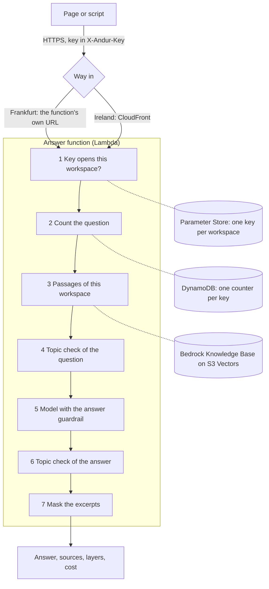
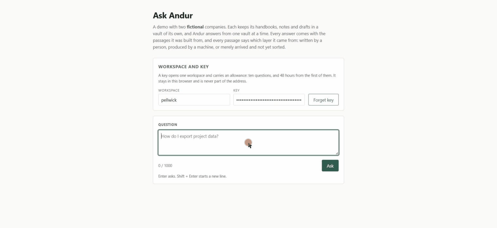

# Svar

Svar is a chatbot. It answers questions from a company's own documents, and
every answer shows its sources: the passages it was built from, each marked
as written by a person, produced by a machine, or merely arrived and not
sorted yet. It is shown with made-up companies. One installation holds
several companies, each in a workspace of its own, and a question asked in
one workspace is never answered from another's documents. It runs on AWS,
defined as code (CDK in Python), and nothing in it bills a monthly base fee.

Svar is one part of a larger system called Andur. Andur is meant to grow
into a secretariat, stage by stage, with a person deciding at every stage.
Its second part is Vard, an agent ([Vard](#vard)); more will follow. The
stack, its resources and the code carry Andur's name (`AndurStack`,
`X-Andur-Key`, `andur-*`).

Two stacks run from the same code. Andur's main stack runs on AWS in
Frankfurt (`eu-central-1`): a company's documents, the vectors, models,
questions and answers stay in Germany. The second stack, in Ireland (`eu-west-1`) behind CloudFront, is
the comparison track; it holds only the two fictional demo companies of
`knowledge/` and is where models and checks are measured against each other.
Both were last deployed on 16.10.2026.

![An answer on Svar's page in Frankfurt, in German: the question, the answer citing [1], and the sources it rests on, each marked as written by a person](docs/screenshot-answer.png)

## How a question travels



1. The function checks that the key opens the workspace the request names. A
   wrong key gets 401, before the question is counted or read further.
2. The question is counted against the key: one conditional DynamoDB write
   for a demo key, two for a key on a plan (the demo write refuses it and
   hands over the plan, the second counts month and day). A spent demo key
   gets 402, a full monthly or daily quota 429.
3. The knowledge base returns up to ten passages, filtered to the workspace.
   If none matches, the reader gets a fixed sentence and no model is asked.
4. The question is checked for four denied topics: taking or facing legal
   action, a person's own tax return, medical advice, and the private lives
   of people, which includes any question about celebrities, politicians
   and other public figures (`app/denied_topics.py`). In Frankfurt
   gpt-oss-120b does this in
   the region; in Ireland a Bedrock guardrail. A refused question costs no
   call of the answer model and returns no sources; in Frankfurt the check
   itself is one to three calls of gpt-oss-120b.
5. The answer model (Qwen3 235B in Frankfurt, Nova Pro in Ireland) gets the
   passages and a prompt that tells it to answer from them alone and cite
   them. A guardrail on the same call masks names, e-mail addresses, phone
   numbers and addresses, and withholds the answer if the passages do not
   carry it (the grounding check).
6. The answer, without its citation numbers, is checked for the same four
   topics.
7. A second guardrail masks the same personal details in the excerpts of the
   sources. The response carries the answer, every source with its layer and
   whether it is cited, the tokens, and the cost in USD.

If AWS fails the search, the topic check of the question or the model call,
the question is given back to the key, though never after a timeout: such a
call may have run and been paid for. `app/handler.py` runs steps 1 and 2
(`keys.py`, `budget.py`), `app/answering.py` steps 3 to 7. More:
[docs/architecture.md](docs/architecture.md).

## Decisions and what each one costs

97 decisions are written down with their dates and reasons in
[docs/decisions.md](docs/decisions.md). The ones that shape the system:

- **Nothing with a monthly base fee** ([decisions.md:69](docs/decisions.md)):
  S3 Vectors behind a Bedrock knowledge base instead of a search cluster, so
  an idle month costs cents. The price is control over retrieval: Bedrock
  returned whole documents with Markdown tables under every chunking tried,
  so documents are split at their headings before the upload
  ([decisions.md:82](docs/decisions.md)).
- **One installation, workspaces kept apart by a metadata filter**
  ([decisions.md:157](docs/decisions.md)). The price: the separation rests on
  a filter in every query, not on separate deployments, so it has to be
  tested and measured, not assumed (see [Privacy](#privacy-and-separation)).
- **A key is a budget, not a password** ([decisions.md:282](docs/decisions.md)):
  ten questions within 48 hours of the first for a demo key, a monthly and a
  daily quota for a key on a plan. The price: whoever holds a key can ask
  until it is spent; a leaked demo key is a leak of ten questions.
- **In Frankfurt the function's URL is the address, without CloudFront**
  ([decisions.md:978](docs/decisions.md)): no setting keeps CloudFront's edge
  locations inside Germany. The price: no domain of its own and no WAF, so
  a flood is capped only by the number of executions Lambda allows at once.
  The stack is built to reserve 10 for the function there, 5 for questions
  plus 5 more for loading the page, one pool that questions may take whole;
  the Frankfurt account allows only 10 executions in all, so the stack runs
  there without the reservation, and
  the account's limit is the cap
  ([docs/operating.md](docs/operating.md#another-region)).
- **In Frankfurt a model in the region checks the topics**
  ([decisions.md:693](docs/decisions.md), [:731](docs/decisions.md)),
  because the one guardrail tier that reads German needs a profile that
  checks in six regions. The price: a model call per check, 0.30 USD for
  957 checks (below).
- **The grounding check withholds at 0.8 in Frankfurt**
  ([decisions.md:792](docs/decisions.md)), the threshold that withheld the
  most made-up answers without withholding a right answer to German
  documents. The price: it withholds right German answers to English
  documents. Checking those in English was measured and not built, because
  it also let made-up answers through
  ([decisions.md:1024](docs/decisions.md)).
- **Measured through the function's own code path**
  ([decisions.md:1130](docs/decisions.md)), against the deployed knowledge
  base and the deployed function's settings. The price: every measurement
  calls real models and costs real money, and one run is one sample, since
  the models do not repeat themselves even at temperature 0
  ([decisions.md:367](docs/decisions.md)).

## Measured

Five scripts measure the deployed stack: `evaluate` (fixed questions with
expected facts), `control_eval` (questions built to tempt a model away from
its sources), `topic_probe --deployed` (the denied topics),
`grounding_probe` (fixed right and made-up answers against the grounding
check) and `rehearsal` (a new workspace set up from nothing). They run the
function's own code with the deployed function's settings and knowledge
base, and its guardrails or copies of them that a script creates and
deletes; `topic_probe` and `grounding_probe` are also run before a deploy,
to measure a change before it goes live
([decisions.md:576](docs/decisions.md)). The numbers below were measured
after the deploy of 14.10.2026 in Frankfurt and of 16.10.2026 in Ireland,
against the deployed stack. Frankfurt's deploy of 16.10.2026 gave each
model its own prompt wording and kept Qwen3 235B's as it was
([decisions.md:952](docs/decisions.md)). How each works:
[scripts/README.md](scripts/README.md).

### Frankfurt, 14.10.2026, Qwen3 235B

| What | Result |
|---|---|
| English questions on English documents | 30 of 30 right; all 22 answerable ones cite the expected document |
| German questions on English documents | 28 of 32 right; the 4 wrong ones are answers the grounding check withheld |
| German questions on German documents | 26 of 26 right; all 20 answerable ones cite the expected document |
| Questions built to tempt the model | 36 of 42 right; 0 of 34 answers added a figure of their own; 29 of 29 German questions answered in German; 8 of 8 advice questions refused |
| Denied topics, three runs, 957 checks | every one of 45 denied questions, 32 denied answers and 11 advice questions refused; none of 87 harmless questions, 87 harmless answers and 57 questions of the evaluation sets refused |
| Grounding check at 0.8 | withheld 71 of 104 made-up answers in this run (75 of 104 in the run the threshold was chosen on, [decisions.md:807](docs/decisions.md); one run is a sample); let through 19 of 19 right German answers to German documents and 16 of 19 to English documents |
| Median time per question, retrieval to cost line, from a laptop in Germany | 3.0 s (English), 2.3 s (German on English documents), 2.8 s (German on German documents) |

**Setting up a new workspace**, measured on 07.10.2026 with a fictional craft
firm and seven German documents: 31 seconds of machine time from checking
its folder to the first right answer, 3 for its workspace and key, 16 to
upload and index its documents, 8 for the first question, answered with the
right figure and the right document cited. The whole rehearsal with all
measurements took 11 minutes 12 seconds.

**Where the weak spots are:**

- Every wrong answer in these Frankfurt runs was withheld by a check; none
  reached the reader with a wrong figure. All of them are German answers to
  English documents. A withheld answer's text is not kept, so whether each
  was right is not known; that the check withholds right ones there is
  measured (3 of 19 in the grounding row above).
- The models do not answer the same question the same way twice. One run of
  each set is a sample, not a rate.
- The German documents of the fictional craft firm are not in this
  repository, so the German-on-German results cannot be repeated from it.

### Ireland, 16.10.2026, Nova Pro

| What | Result |
|---|---|
| English questions on English documents | 30 of 30 right in each of two runs; all 22 answerable ones cite the expected document |
| Median time per question, retrieval to cost line, from a laptop in Germany | 2.9 s and 2.8 s |

Each answer model now has the prompt it was measured with: Nova Pro the one
of 06.10.2026, Qwen3 235B in Frankfurt its own, unchanged
([decisions.md, 14.10.2026](docs/decisions.md)). After the deploy of
14.10.2026 Ireland had the prompt measured with Qwen3 235B and got 27 of 30
in two runs: it made Nova Pro write "The sources do not answer this
question." where the sources do. One question (q20) was right only 2 of 10
times with either prompt when asked alone on 14.10.2026; it was right in both
runs here, which is a sample, not a fix.

## Privacy and separation

- **Where the data is.** In Frankfurt, all 10 places AWS reports for the
  stack are in `eu-central-1`: documents bucket, embedding model, vector
  index, answer function, answer model, topic model, answer guardrail,
  excerpt guardrail, budget table and the function's log. Bedrock's model
  invocation log is off. Every address the URL's host name resolved to (12
  on 14.10.2026) lies in `eu-central-1` by AWS's `ip-ranges.json`; plain HTTP got no
  connection on any of them, HTTPS served the page and refused a question
  without a key with 401.
- **Companies kept apart.** On 14.10.2026 the craft firm's key was refused in
  another workspace with 401, and a search in that workspace returned five
  passages, none of them from the craft firm's documents.
- **Keys.** A key is stored as a SecureString parameter, and the budget table
  holds only its SHA-256. The page keeps the key in the browser and never
  puts it in the address.
- **Logs.** One line per request, without the question, the key or its hash.
  The one exception is a crash: its traceback can quote what the code choked
  on ([app/README.md](app/README.md#logs)).
- **Masking.** Names, e-mail addresses, phone numbers and addresses are
  masked in the answer and in the excerpts of its sources, and the page shows
  the excerpts as the function returns them. In the Frankfurt runs of
  14.10.2026, 50 of the 231 excerpts returned for the English questions
  carried a masked detail. The masking is statistical: a first name standing
  alone stayed readable in two excerpts in a browser test on 23.09.2026, and
  it also masks what is no person, such as a company name in "{NAME}
  Customer Support". Documents that must not show a name to a reader must not
  hold it.

## Cost, measured

- **Idle:** cents per month. S3 Vectors storage and a few megabytes of
  documents; nothing else runs while nobody asks.
- **Per question in Frankfurt, 14.10.2026:** 0.0024 USD on average for the
  English questions, 0.0014 for German questions on English documents and
  0.0021 for German questions on German documents.
- **Per question in Ireland, 16.10.2026:** 0.0038 USD on average, Nova Pro.
- **These averages are too low.** An answer the answer guardrail withheld
  carries `cost_usd: null`, because Bedrock reports no tokens for it although
  it charges the model call ([docs/costs.md](docs/costs.md)). The averages
  count only the questions with a known cost: 3 of 30, 8 of 32 and 1 of 26
  questions in Frankfurt and 3 of 30 in each Ireland run had none.
- **The topic check in Frankfurt:** 0.30 USD for 957 checks.
- **Setting up the craft firm** with all its measurements on 07.10.2026: 0.70
  USD, at most 0.75.

Prices, the counter, the page and how each number was taken:
[docs/costs.md](docs/costs.md).

## Known limits

- **The masking is a filter, not a guarantee** (above).
- **Citations are the model's.** The prompt asks for them; the model does not
  always give them.
- **The topic check is not exact.** The same question can get a different
  verdict in another run; every change to the topics is measured first
  ([scripts/README.md](scripts/README.md#topic_probe--what-the-denied-topics-refuse-before-a-deploy)).
- **The grounding check withholds right answers.** In Frankfurt, German
  answers to English documents; in Ireland the threshold is 0.7, AWS's own
  example value, not a tuned one. Every answer logs both scores, so the
  threshold can be moved on evidence.
- **The cost of a withheld answer is not counted** (above).
- **Frankfurt has no domain of its own and no WAF.** The page and `/ask` are
  the function's URL, `https://<id>.lambda-url.eu-central-1.on.aws/`; the
  workspace key is the gate there.
- **The demo corpus is small:** 37 Markdown documents of two fictional
  companies, uploaded as 147 sections.

## Vard

Vard is an agent. He takes on one responsibility after another, works on
each with tools, and a person decides what happens. His first is the
receiving check: he fetches a delivery note that has come in, fetches the
purchase order it names, compares them and reports what differs. A support
inbox, to be tried on the made-up software company Quillmoor, is planned as
the next.

The loop is `vard/engine.py`: a model calls tools turn after turn until a
tool that closes the task has run, it answers without a tool, or the step
limit is reached (8 for the receiving check). Each tool carries a level:
allowed, ask (runs only when a person approves) or denied. A call to a tool
that is not offered, a denied one, one nobody approved and one without its
required fields is not run; the model is told why, and the call counts as
invalid. The loop knows no task of its own: a responsibility brings the task
text, the tools and the step limit (`vard/receiving.py`). The receiving check
has five tools, all allowed, and none of them books.

**Measured on 20.10.2026 in Frankfurt**, twelve made-up cases, two runs of
every model ([decisions.md:1216](docs/decisions.md)):

| Model | Passed, of 24 | USD, both runs | Median seconds per case |
|---|---|---|---|
| Nemotron 3 Super | 23; the 24th got no answer, a read timeout | 0.024 | 4.4 and 4.3 |
| Devstral 2 123B | 23 | 0.044 | 2.6 and 2.5 |
| MiniMax M2.1 | 23 | 0.061 | 6.2 and 7.4 |
| gpt-oss-20b | 23 | 0.010 | 2.0 and 2.0 |
| gpt-oss-120b, Qwen3 235B, Qwen3 32B, MiniMax M2.5, GLM 4.7 Flash | 22, 22, 21, 21, 17 | 0.010 to 0.052 each | 1.1 to 14.3 |
| Claude Sonnet 4.6, EU profile | 24 | 0.572 | 4.9 and 4.9 |
| Nova Pro, EU profile | 17 | 0.133 | 3.1 and 3.1 |

The runs took 11 min 56 s and 8 min 34 s and cost 0.488 and 0.490 USD for
all eleven models. A model's result moved by up to two cases between the
runs at the same settings, so twelve cases do not tell the leaders apart. The
four Frankfurt models at 23 of 24 are the candidates; the next build of Vard
picks among them with more and harder cases. Claude Sonnet 4.6 and Nova Pro run behind the
EU profile, which routes to every EU region, and stand as a comparison only.

**What Vard does not do yet.** So far he is only measured, not in
operation. Nothing of him is deployed, nothing starts him when a delivery note comes in, he remembers no
correction, and he books nothing. The documents come from the case file, not
from a real system.

```bash
python -m scripts.receiving_probe --out receiving.json   # every Frankfurt model, at most 1.50 USD
```

It calls real models in `eu-central-1` and costs money; run it only when
asked. `--max-usd` stops it before any call that could take it past the
limit. How it scores:
[scripts/README.md](scripts/README.md#receiving_probe--which-model-vard-checks-deliveries-with).

## Build and test it

Needs Python 3.11+ (tested on 3.14, the function's runtime in Lambda),
Node.js 22, the AWS CDK CLI (`npm install -g aws-cdk@2.1142.0`) and, for
everything after the tests, AWS credentials. `constraints.txt` pins every
Python package to the version the tests pass on. The tests and `ruff` need
no AWS; CI (`.github/workflows/ci.yml`) runs them on every push and pull
request to `main`, and `cdk synth` for both regions.

```bash
python -m venv .venv && . .venv/Scripts/activate   # Linux/macOS: . .venv/bin/activate
pip install -e ".[dev]" -c constraints.txt
pytest -q                                  # 1,521 tests, no AWS needed; one is skipped without a time zone database
ruff check && ruff format --check
```

The commands below build the main stack, in Frankfurt. Without
`-c region=eu-central-1` and `--region eu-central-1`, and with `eu-west-1` in
the `cdk bootstrap` line, the same commands build the comparison stack in
Ireland.

```bash
cdk bootstrap aws://<account>/eu-central-1          # once per account and region
cdk deploy -c region=eu-central-1                   # builds everything
python -m scripts.workspace --region eu-central-1 add quillmoor > /dev/null   # stores the workspace's key
python -m scripts.ingest --region eu-central-1      # uploads the demo corpus and syncs
python -m scripts.ask "How do I export project data?" --workspace quillmoor --region eu-central-1
cdk destroy -c region=eu-central-1                  # removes it; the documents bucket stays
```

A new AWS account whose Lambda limit is 10 concurrent executions needs
`-c answer_max_concurrency=none` on the `cdk` commands as well
([docs/operating.md](docs/operating.md#another-region)). Then open the stack
output `WebUrl` in a browser; the page asks for a workspace and its key. How
to get a key, what every field and status means, and how to ask with curl:
[docs/operating.md](docs/operating.md) and [app/README.md](app/README.md).

A walkthrough of one question, recorded on 28.09.2026 on the Ireland stack
with Nova Pro, when the page was still called Ask Andur:



## Further reading

| Topic | Where |
|---|---|
| Architecture, the way in, what the stack creates | [docs/architecture.md](docs/architecture.md) |
| Deploy, fill, ask, test, tear down | [docs/operating.md](docs/operating.md) |
| Why documents are uploaded as sections | [docs/retrieval-findings.md](docs/retrieval-findings.md) |
| What it costs, measured and priced | [docs/costs.md](docs/costs.md) |
| Every decision, dated | [docs/decisions.md](docs/decisions.md) |
| The answer function: request, answer, errors, guardrails, logs | [app/README.md](app/README.md) |
| The page | [web/README.md](web/README.md) |
| The scripts and the measurements | [scripts/README.md](scripts/README.md) |
| Vard's loop and how his measurement scores | [vard/engine.py](vard/engine.py), [scripts/README.md](scripts/README.md#receiving_probe--which-model-vard-checks-deliveries-with) |
| The demo corpus and its metadata | [knowledge/README.md](knowledge/README.md), [docs/metadata.md](docs/metadata.md) |

## How it was built

Built with Claude Code. The author set the goals, made every decision and
checked the results.

## Licence

This repository is a public portfolio piece; nothing in it is sold.
Proprietary, all rights reserved: using, copying or passing on the code needs
the author's written permission, see [LICENSE](LICENSE). The demo documents
in `knowledge/` are CC0 ([knowledge/README.md](knowledge/README.md)).
