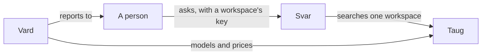

# Andur

Andur is meant to grow into a secretariat for a small business, stage by
stage, with a person deciding at every stage. It is built from few agents,
each with one clear responsibility, not from a swarm. Today it has three
parts, each in a folder of its own.

| Part | Folder | What it does | Where it stands |
|---|---|---|---|
| Taug | [taug/](taug/README.md) | What the other parts stand on: each company's documents in a workspace of its own, in three layers (written by a person, produced by a machine, arrived and not sorted yet), the knowledge base over them, the workspace keys, and the regions and models with their prices. | Runs on AWS as part of the one stack. |
| Svar | [svar/](svar/README.md) | A chatbot. It answers questions from the documents of one workspace, and every answer shows its sources. | Runs on AWS in Frankfurt, the main stack, and in Ireland, the comparison stack; both were last deployed on 21.10.2026. |
| Vard | [vard/](vard/README.md) | An agent. He checks a delivery note against its purchase order with tools and reports what differs to a person, who decides. | Measured, not deployed. |

## How the parts hang together



- **One stack for now.** `AndurStack` ([infra/app.py](infra/app.py),
  [infra/stacks/andur_stack.py](infra/stacks/andur_stack.py)) builds Taug's
  and Svar's parts together. Vard is on no stack.
- **Some of Taug runs inside Svar's function.** The function's code package
  is the folder `svar/app/`, so what it needs of Taug lies there: the key
  check (`svar/app/keys.py`), the workspace filter of every search
  (`svar/app/retrieval.py`), the three layers (`svar/app/citations.py`) and
  the rule for workspace names (`svar/app/intake.py`). They stay there until
  the stack is split.
- **Taug calls Svar for a key's plan.** The plan is what Svar counts
  questions against, so the step that puts a key on a plan is Svar's
  (`svar/scripts/plan.py`); Taug's workspace script calls it.
- **Vard reads Taug's model table** (`taug/infra/answer_models.py`) for the
  models he is measured with and their prices.
- **The names stay Andur's.** The stack, its resources and the names a user
  sees carry Andur's name (`AndurStack`, `X-Andur-Key`, `andur-*`).

## What is where

```
README.md        this overview
AGENTS.md        rules for coding agents
conftest.py      the test setup every part's tests share
docs/            the one stack: architecture, operating, costs, every decision
infra/           the CDK entry and the one stack that wires the parts together
scripts/         the rehearsal of a new workspace across the parts
tests/           tests of the whole stack and of the rehearsal
knowledge/       two made-up companies, the demo documents
taug/            Taug: stack blocks, scripts, docs, tests
svar/            Svar: the answer function (app/), the page (web/), stack blocks, scripts, tests
vard/            Vard: his loop, his first responsibility, his measuring scripts, tests
```

## Build and test it

Needs Python 3.11+ (tested on 3.14, the function's runtime in Lambda),
Node.js 22, the AWS CDK CLI (`npm install -g aws-cdk@2.1146.0`) and, for
everything after the tests, AWS credentials. `constraints.txt` pins every
Python package to the version the tests pass on. The tests and `ruff` need
no AWS; CI (`.github/workflows/ci.yml`) runs them on every push and pull
request to `main`, and `cdk synth` for both regions. Coding agents such as
Claude Code work in this repository under the rules in
[AGENTS.md](AGENTS.md).

```bash
python -m venv .venv && . .venv/Scripts/activate   # Linux/macOS: . .venv/bin/activate
pip install -e ".[dev]" -c constraints.txt
pytest -q                                  # 1,581 tests, no AWS needed; one is skipped without a time zone database
ruff check && ruff format --check
```

How to deploy the stack and ask Svar: [svar/README.md](svar/README.md#deploy-it-and-ask).

## Further reading

| Topic | Where |
|---|---|
| Architecture, the way in, what the stack creates | [docs/architecture.md](docs/architecture.md) |
| Deploy, fill, ask, test, tear down | [docs/operating.md](docs/operating.md) |
| What it costs, measured and priced | [docs/costs.md](docs/costs.md) |
| Every decision, dated | [docs/decisions.md](docs/decisions.md) |
| Taug, and its scripts | [taug/README.md](taug/README.md), [taug/scripts/README.md](taug/scripts/README.md) |
| Svar, and its scripts | [svar/README.md](svar/README.md), [svar/scripts/README.md](svar/scripts/README.md) |
| Vard, and his scripts | [vard/README.md](vard/README.md), [vard/scripts/README.md](vard/scripts/README.md) |
| The rehearsal of a new workspace | [scripts/README.md](scripts/README.md) |
| The demo corpus and its metadata | [knowledge/README.md](knowledge/README.md), [taug/docs/metadata.md](taug/docs/metadata.md) |

## Licence

This repository is a public portfolio piece; nothing in it is sold.
Proprietary, all rights reserved: using, copying or passing on the code needs
the author's written permission, see [LICENSE](LICENSE). The demo documents
in `knowledge/` are CC0 ([knowledge/README.md](knowledge/README.md)).
